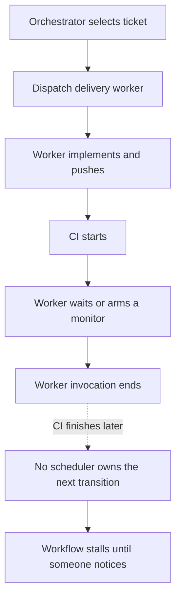
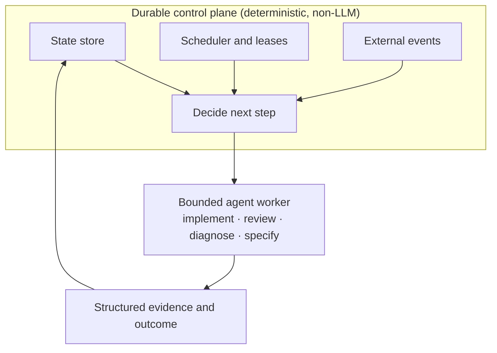
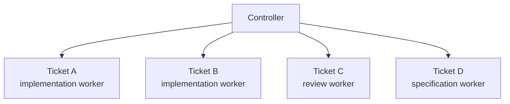
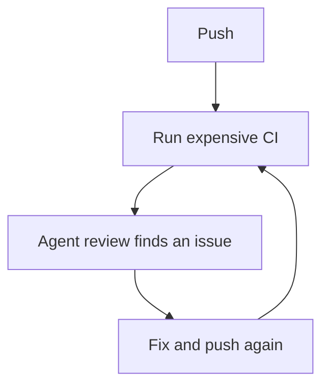
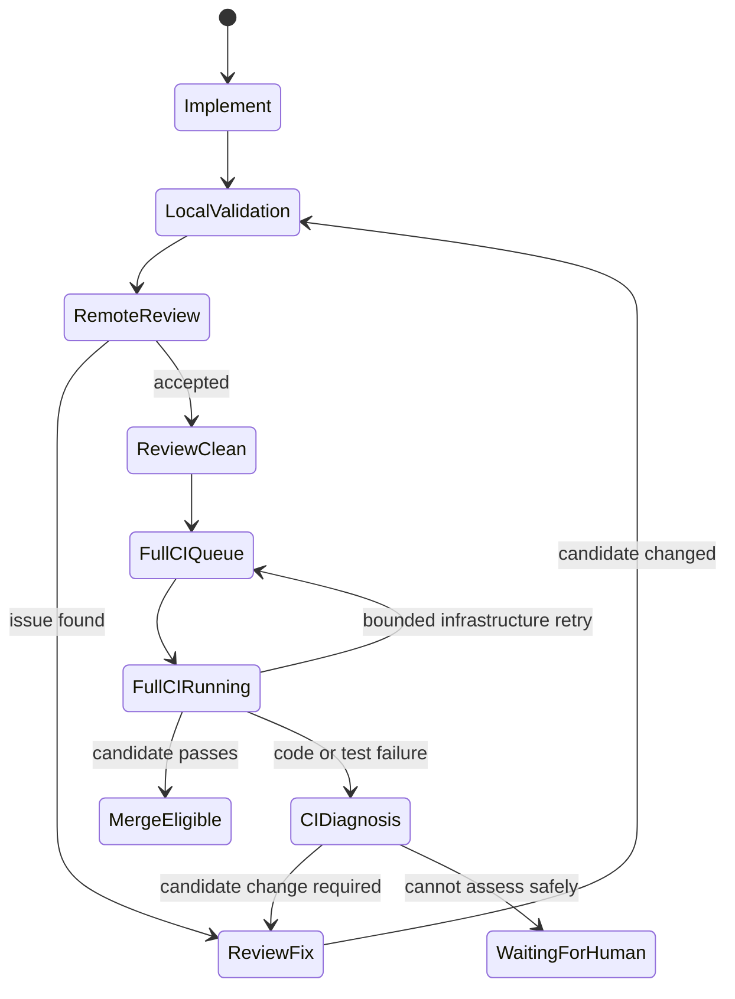
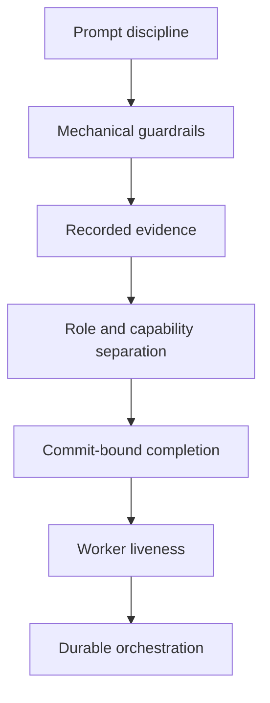
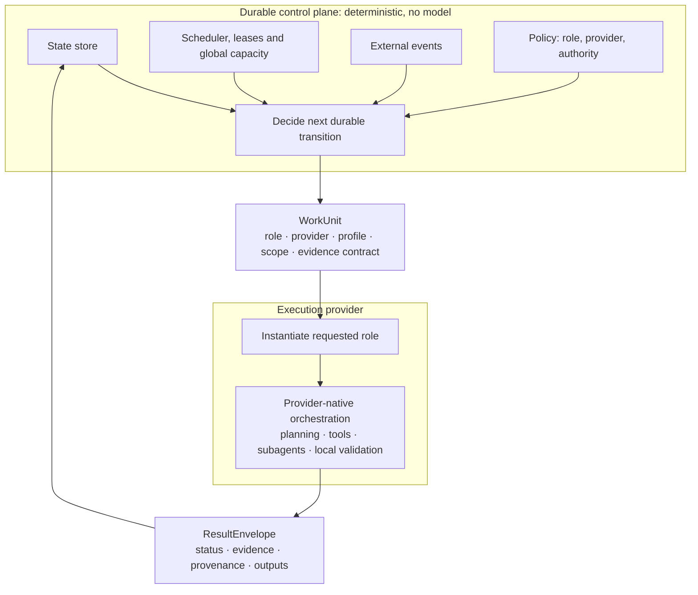

# From conversational loop to durable controller

> **Implementation status, verified 2026-08-31.** The observe-only Phase 1 controller described here is implemented and running on a timer on a real host. It persists decisions but cannot dispatch workers. The merge-join executor is exercised in dry-run mode behind a backend that refuses to merge. Later phases remain work in progress. This article separates those shipped boundaries from the target architecture.
>
> **Update, 2026-11-15.** The later phases have since shipped and the conversational loop is retired. The body below is kept as the dated record of Phase 1. [What was built afterwards](#postscript-november-2026-what-was-built-afterwards) is at the end.

## The short version

Mechanical guardrails around agent work are necessary, but they are not sufficient if the workflow executing those guardrails depends on one long-lived conversation remembering to continue.

The harness originally concentrated on governing what agents did:

- acceptance contracts;
- deterministic gates;
- commit-bound review evidence;
- credential-isolated reviewers;
- three-outcome checks;
- diff budgets;
- eval ledgers;
- worker heartbeats.

Those mechanisms remain useful.

The operational system later exposed a different class of failure: **workflow liveness itself was conversational**. An orchestrator had to remember to re-arm its next wake-up, subagents could wait on CI and never get re-entered after the wait, and a crash could take the scheduler and its in-session watchdog down together.

The resulting architectural rule is:

> **An agent may decide how to perform a workflow transition. It should not be the durable authority deciding whether the workflow continues.**

That responsibility belongs to deterministic software with persisted state.

## What changed in our understanding

The earlier work focused on a valid problem: an agent can be fluent and wrong while reporting green. The answer was to make claims mechanically checkable and to separate authoring capability from review capability.

That did not address a different question:

> If the current agent process or conversation disappears, who knows what should happen next?

For a simple interactive coding session, "the human restarts it" is a perfectly reasonable answer. For an autonomous delivery loop, it is not.

A system that can prove its checks but cannot reliably resume the workflow after a wait or crash is governed but not durable.

## The failure pattern

A representative shape looked like this:



A heartbeat does not fix that.

The worker may have reported a healthy heartbeat before it yielded. What is
missing is **workflow durability across worker boundaries**, not worker
liveness.

That distinction matters enough to state explicitly:

| Mechanism | Question it answers |
|---|---|
| heartbeat | Is worker X still plausibly doing task Y? |
| controller | What workflow transition should happen next? |

Conflating the two produces increasingly elaborate watchdogs around a conversational scheduler.

## The revised architecture



The controller owns state, retries, external waits, work leases, timeouts and concurrency. Agents perform bounded transitions and return structured outcomes.

A worker becomes disposable. If it disappears, the workflow state remains.

## What Phase 1 now proves

The first implementation is a standalone, project-neutral package with a project
adapter on the far side of a narrow interface. One bounded invocation:

1. reconciles external ticket and pull-request state;
2. recovers expired leases;
3. calculates runnable transitions under named capacity pools; and
4. persists `WOULD_DISPATCH` or `HOLD` decisions in SQLite.

Each instance has separate configuration, state and logs. A per-instance lock
refuses concurrent ticks, and every command uses the same three outcomes: clean,
a real verdict, or could-not-assess. A systemd timer now runs that bounded tick on
a real host. The installation exposed useful operational failures—adapter
dependencies, service environment and filesystem ownership—and each failed
loudly rather than being read as a clean observation.

The important limitation is enforced in configuration, not left to prose:

```toml
dispatch_mode = "observe"  # "automatic" is refused in Phase 1

[pools]
implement = 4
review = 2
```

A separate merge-join executor now consumes a SHA-pinned plan and journals each
obligation so a retry does not repeat an effect. Changed evidence stops the plan.
For now its only writing backend refuses to merge, and the repository bridge runs
it as a dry run. This proves idempotency and stale-evidence handling without
quietly granting the controller merge authority.

Phase 1 therefore proves durable observation and decision recording. It does not
yet prove agent dispatch, automatic retries around workers, model-routing
enforcement or unattended merging.

## This still supports parallel agents

Moving orchestration out of the conversation does **not** imply serial execution.

It gives concurrency somewhere explicit to live:



Each worker can run in an isolated worktree and test environment. The controller
owns the leases and capacity limits.

This also separates highly parallel, cognition-heavy work from scarce
infrastructure whose capacity must be bounded.

For example:

| Capacity pool | Slots |
|---|---:|
| implementation | 4 |
| review | 4 |
| full CI | 2 |
| merge | 1 |

This is backpressure, not a lack of autonomy.

## The review/CI cascade made the boundary visible

The same architecture problem appeared in a different form around CI.

The delivery loop had evolved toward:



The first mitigation was to review locally before the first push. That is sound, but the stronger design is to make the workflow phases explicit:



The controller can keep review convergence cheap and admit only a review-clean
candidate to the expensive suite. If full CI exposes a product or test problem,
the workflow returns through diagnosis, correction, local validation and review.
A changed commit never inherits the earlier review-clean state. Infrastructure
failures may return directly to the CI queue under a bounded retry policy; an
unclassifiable result fails closed rather than being treated as a pass.

This is difficult to express reliably when the orchestration state exists mostly as instructions inside one ongoing conversation. It becomes straightforward when the states are data.

## Waiting for CI should not require an LLM

There is a practical cost benefit to this boundary. In the conversational loop,
checking whether CI has finished can mean another agent turn: read the checks,
interpret the status, decide to wait and arrange another wake-up. Each such turn
uses model tokens even when there is no engineering decision to make.

In the target architecture, that work is ordinary software. The implementation
worker pushes, returns the PR number and exact head SHA, and exits. The
controller persists the wait and the identifiers it needs to resume it.
Subsequent timer ticks query GitHub and apply the configured transition rules.
No model invocation is needed to read a queued, running or completed status.

| CI observation | Controller action | Model work |
|---|---|---|
| Queued or running | Persist the wait; check again on a later tick | None |
| Passed for the expected SHA | Advance when the other required evidence permits | None for the status decision |
| Recognised transient infrastructure failure | Schedule a bounded retry using a supported provider operation | Usually none |
| Test or build failure needing investigation | Dispatch a bounded diagnosis or repair worker with relevant logs | Yes |
| Missing or ambiguous evidence | Record could-not-assess and apply bounded recovery policy | Only if investigation requires it |

External waits release worker capacity. After a controller restart, the stored
PR, SHA and run identifiers allow monitoring to resume. A pass on an old commit
cannot qualify a replacement candidate.

This removes model calls from routine monitoring, not the cost of CI itself.
Controller ticks still consume CPU, memory, storage and GitHub API quota.
Diagnosis, implementation and review still use model tokens. Provider permissions
also remain real constraints: moving a retry into Python does not grant the
credential permission to rerun a GitHub workflow. An unsupported retry must remain
visible rather than becoming an unbounded sequence of empty-commit pushes.

**This benefit is designed, not measured.** Phase 1 only observed, so it could
not show it. The controller has since replaced the loop's CI monitoring (see the
postscript), but the source system has not yet compared model usage for routine
orchestration before and after. An evaluation should separate that usage from
diagnosis and repair, alongside CI retries and time-to-completion. A quieter
agent session alone is not proof of cheaper delivery.

## What changed in reviewer identity enforcement

The earlier [double-loop case study](enforcing-the-double-loop-for-agents.md)
separates credential isolation, fresh context and model or persona separation.
The rearchitecture did not overturn that distinction. It exposed a narrower flaw
in how credential isolation had been enforced: an exact GitHub login string had
been treated as stable proof of reviewer authority.

**A literal login string is too weak to prove that authority.** The same GitHub App
can appear differently across API surfaces—as a bare name, with a bot suffix or in
an App-specific form. A gate tied to one exact spelling can silently stop enforcing
the intended boundary while still looking secure.

The stronger language is:

> Review evidence is trusted because it was produced by a capability the author does not possess, its provenance can be verified, and it is bound to the exact commit being judged.

The login is audit metadata. The capability/provenance is the security property.

This does not weaken the argument for reviewer isolation; it makes it more precise.

## Rule-based model routing adds diversity, not independence

Before the durable-controller work, the harness selected a model tier from rules
about the activity being performed. The policy considered factors such as whether
the work was routine implementation, orchestration, investigation or review. It
did not permanently assign one named model to all coding and another to all
reviews.

During the period described here, those rules commonly routed routine
implementation to Sonnet and higher-reasoning orchestration or review work to
Opus. These names describe the configuration used at the time, not an
architectural requirement. The routing rules could select different models as
their capabilities, costs or the risk of the activity changed.

The policy was not perfectly enforced. Model inheritance and sub-dispatch
occasionally selected a different tier from the one the activity rules required,
and the ledger did not always preserve the complete dispatch chain. The
historical record therefore contains a mixture of fresh-context review and
deliberate model-tier separation rather than one uniform reviewer configuration.

Each layer contributes something different:

| Review layer | What it adds |
|---|---|
| deterministic tools | repeatable mechanical verification |
| fresh-context reviewer using the same configured tier | another pass without the author's conversation history |
| reviewer routed to a different or stronger tier | context separation plus model-tier diversity |
| reviewer from a different model family or provider | broader reasoning diversity |
| credential-isolated reviewer | authority the author cannot forge; not reasoning independence |
| human reviewer | independent authority and judgement |

A reviewer selected under a higher-reasoning rule can find defects the
implementation model missed, and the recorded reviews show that this happened.
It is still not automatically an independent audit: models from the same family
may share blind spots. The review should be retained when its measured yield
justifies its cost, with the routing decision, actual model, role and evidence
recorded.

The durable controller should preserve the **routing policy**, not the historical
Sonnet/Opus pairing. Model selection belongs in configurable rules based on the
transition, activity and risk class. Phase 1 does not dispatch workers, so it
neither removes nor proves this policy. The worker-dispatch phase must evaluate
the rules explicitly, prevent accidental inheritance, and record both the
requested and actual model.

## The human boundary becomes risk-based

A durable controller makes human intervention easier to model explicitly rather than leaving it as an accidental stall.

One useful policy shape is:

| Risk class | Example | Human approval |
|---|---|---|
| low | docs, tests, internal tooling | normally no |
| ordinary | product code with established deterministic evidence | potentially no |
| high | auth, security, migrations, unattended actions | yes |
| control plane | scheduler, gates, reviewer policy, identity, CI/deploy policy | mandatory |

The last class matters most.

An autonomous system should not be able to weaken the rules that judge a change and immediately benefit from the weakened rule. A control-plane PR should be evaluated under the **base branch's** policy and require stronger authority.

That is not a temporary compromise on the road to "full autonomy". It is a
trust boundary.

## What the earlier deep dives still support

This is the third article in the series. The two earlier articles make different,
but related, claims:

| Claim retained after the rearchitecture | Earlier source |
|---|---|
| An agent's green result is not enough evidence, and the acceptance contract must remain open to challenge. | [Governing the double loop](enforcing-the-double-loop-for-agents.md) |
| Review evidence should be bound to the exact commit, and author and reviewer capabilities should be separated when review is a gate. | [Governing the double loop](enforcing-the-double-loop-for-agents.md) |
| A second agent can add a useful review layer without becoming an independent audit. | [Governing the double loop](enforcing-the-double-loop-for-agents.md) |
| Missing evidence must remain `could-not-assess`, never silently become a pass or a zero. | [Evals for an agent loop](honest-evals-for-an-agent-loop.md) |
| Overrides, denominators and who caught each mistake must be recorded if the metrics are to mean anything. | [Evals for an agent loop](honest-evals-for-an-agent-loop.md) |
| Deterministic evidence is stronger than an agent's self-report. | [Governing the double loop](enforcing-the-double-loop-for-agents.md) and [Evals for an agent loop](honest-evals-for-an-agent-loop.md) |

Those claims concern how agent work is governed and measured. The rearchitecture
changes a different concern: **where workflow state, scheduling and recovery
belong**. Moving those responsibilities into a durable controller does not make
the earlier controls less useful.

## What the heartbeat pattern now means

The companion cookbook heartbeat pattern remains useful, but with a narrower contract:

> Heartbeats monitor or renew **worker leases**. They do not provide **workflow durability**.

If a worker is doing a 20-minute local test run, a deadline-based beat is useful evidence that its lease should remain valid.

If the workflow is waiting for an external CI run, the worker should normally return. The controller records `FULL_CI_RUNNING` and the run ID. No conversational heartbeat should be required to make the post-CI transition happen.

That boundary is now explicit in the cookbook.

## Do we need Temporal?

Not necessarily.

The architecture is being proved first with a small deterministic controller.
Phase 1 has already established persisted reconciliation, lease recovery, runnable
decisions and a periodic timer. Dispatch, worker execution, merge policy and board
projection remain later phases.

That split matters: the current controller can observe and explain without holding
write authority. A quiet day is not enough to enable dispatch; its decisions must
match meaningful human-operated activity, and disagreements or could-not-assess
ticks extend the observation period.

Once the remaining semantics are stable, a durable workflow engine such as Temporal may become attractive because it provides persistence, retries, timers and activity execution as first-class primitives. At that point it replaces infrastructure whose requirements are understood rather than being adopted because orchestration diagrams look better with a workflow engine box.

## What the rearchitecture taught us

The harness evolved through several boundaries:



None of the earlier layers became useless when the next one appeared.

The additional lesson is this:

> **Mechanical governance of agent work is not enough if the machinery deciding what happens next is itself ephemeral conversational state.**

A production agentic loop needs both sides:

- governed workers;
- durable orchestration.

The companion cookbook pattern, [Durable controller, disposable agent workers](https://github.com/msbi-ltd/agentic-harness-cookbook/blob/main/patterns/durable-controller-agent-workers.md), describes the implementation shape in a shorter reusable form.

## Postscript, November 2026: what was built afterwards

Everything above describes the system as it stood on 2026-08-31, when the
controller could observe and record but not act. This section records what
happened next, checked against the source system on 2026-11-15. The body is
left as written, so the two can be compared.

### The later phases shipped

In early October 2026 the controller stopped being a trial. It now discovers
released work, admits it under capacity pools, dispatches bounded workers,
ingests their results, promotes pull requests and mirrors coarse state to the
project board. The conversational loop, its in-session watchdog and its
supervisor timer are retired; no chat session is part of the delivery path.
Observe mode survives only as an emergency and debugging lever.

Each item Phase 1 "does not yet prove" now exists:

| Phase 1 said | What exists now |
|---|---|
| no agent dispatch | Automatic dispatch of bounded workers from work a person has released on the board |
| no automatic retries around workers | A bounded retry ladder. Substantive failures spend a small count. Infrastructure failures are bounded by repetition and elapsed time instead, after an outage spent the allowance of every work item it touched |
| no model-routing enforcement | Each result records the requested and the actual role, provider and profile, and the model that ran. A mismatch is visible in the record |
| a merge backend that refuses to merge | The controller merges a pull request itself when a short list of conditions is proven on the current head. Everything else waits for a person |

Two details in the body turned out differently. The capacity pools are smaller
than the example shown, and there is no pool or controller state for the full
CI suite. The idea of admitting only a review-clean candidate to the expensive
suite was kept, but built another way: review converges while the pull request
is a draft, and the controller's promotion from draft to ready starts the full
suite once. The state graph in the body was never implemented as drawn. The
real states follow what the controller can observe from outside (the board
column, the pull request's draft flag, review and CI results), plus explicit
states for "held for a person" and "parked after bounded retries".

### The first dispatch design over-corrected

The largest design change after Phase 1 was the lower boundary of the
controller, and it came from a mistake.

The first controller design correctly moved workflow state, scheduling and
recovery out of the conversation. The implementation programme then began to
move too much of the cognitive work out as well. Implementation, review,
diagnosis and specification were becoming fine-grained runtime steps that the
controller managed directly, and the target diagrams in the body above show
that shape. That was the wrong place to standardise. The controller needs a
stable delivery contract. It does not need to recreate the agent runtimes it
dispatches to.

The rule in the body still holds: an agent may decide how to perform a
transition, but it should not be the durable authority deciding whether the
workflow continues. The refinement, reached in September 2026, is its
counterpart:

> **Moving workflow durability into deterministic software does not imply moving provider-native agent orchestration into it.**

The controller decides what role is required, which provider executes it, what
authority it receives, what evidence it must return and what durable transition
follows. The provider decides how that role is carried out, including whether
it uses its own subagents, tools, internal planning or local review loops.

Three mechanisms answer three different questions:

| Mechanism | Question it answers |
|---|---|
| heartbeat | Is execution X still plausibly doing work Y? |
| provider runtime | How is this role being executed right now? |
| controller | What durable workflow state exists, and what transition is allowed next? |

Conflating them leads to one of two bad outcomes: elaborate watchdogs around a
conversational scheduler, which is where the system started, or an
over-centralised controller that starts recreating the agent runtime, which is
where the first dispatch design was heading.



The controller owns durable workflow state, external reconciliation, retries
and recovery, global leases and capacity, risk and authority policy, the role a
transition requires, provider selection, the identity of the inputs and the
evidence required, human gates, and merge authority.

The controller does not own subagent creation, provider-specific session
trees, context-compaction strategy, a provider's planning mechanics, tool-call
sequencing, or delegation between a worker and its own helpers when that stays
inside one bounded invocation. A provider invocation remains disposable: if it
disappears, the durable workflow remains.

### Role is controller policy; subagent is provider implementation

The fine-grained dispatch path was retired in favour of a coarse contract that
separates **semantic roles** from runtime entities. It is now the only dispatch
path.

A role is part of the delivery model and survives a change of provider:
implementer, reviewer, architect, tester, specifier, diagnostician and
acceptance verifier. A role earns its place by creating a stable difference in
authority, routing, evidence, tool access or independence, not because a human
team has that job title. A subagent, by contrast, is an implementation detail
of whichever provider runs the role.

The controller dispatches a work unit that names a role, a provider and an
execution profile:

```text
WorkUnit
- workflow / ticket identity
- immutable repository revision
- semantic role
- selected provider
- execution profile
- scope and allowed write surface
- acceptance criteria
- relevant durable decisions
- tool / authority envelope
- evidence contract
- budget / deadline
```

One provider may execute that with a single process, another with several
subagents of its own. The controller does not model those mechanics. It does
enforce policy at the level of the role: an independent reviewer cannot receive
the authoring credential, cannot write product source, and can be required to
run on a different provider from the author.

The provider returns one result:

```text
ResultEnvelope
- work-unit identity
- terminal status
- requested and actual role, provider and profile
- the model that actually ran
- resulting revision / pull request
- evidence references
- findings
- failure classification
- provenance
```

The invariant that makes this safe is:

> **A provider result must be durably committed before a subsequent controller transition is dispatched.**

Most specialist roles are hosted inside a provider's run. Acceptance
verification is the exception and is dispatched on its own, so that the party
checking the acceptance criteria is not the party that wrote the change.

A provider's internal exchanges may be kept by its own harness for
observability and recovery. The controller does not promote each of them into
workflow state.

### Two kinds of concurrency

The body's "This still supports parallel agents" section shows the controller
running implementation, review and specification workers side by side. The
coarse contract splits that picture in two.

**Global delivery concurrency is the controller's.** It decides how many work
items may be in implementation, in review and in merge at once, across the
whole system, through named capacity pools. These are the hard limits that
protect shared resources.

**Local execution concurrency is the provider's.** Inside one invocation a
provider may use subagents or internal parallelism, within the authority and
resource envelope the work unit gave it. The controller can say "run a
reviewer now, on this provider, under the independent-review profile" without
knowing whether that provider implements the role with one agent or five.

### What deserves to be durable state

The durable boundary is drawn around facts whose loss or ambiguity could
change whether the workflow is correct: which work is released, which role is
running under which lease, what external result is awaited, what is held for a
person, which revision the evidence is bound to.

Provider-internal conditions such as "the reviewer spawned a specialist" or
"a subagent is fixing the fourth test" do not become controller states. That
keeps the distributed state machine small while preserving durability where it
matters. Inside one running role, a provider may implement, validate locally
and review its own work before it returns; the controller sees one result.

A changed commit still never inherits evidence bound to an earlier commit, with
the single proven exception that a head consisting only of merges from the base
branch, with an identical diff, keeps its review.

### Reviewer independence and routing are still controller policy

The coarse boundary does not weaken reviewer isolation. Review evidence is
trusted because it was produced by a capability the author does not hold, its
provenance can be verified, and it is bound to the exact commit being judged.
The division of labour is:

- the controller decides that an independent reviewer role is required;
- the controller may require a different provider or capability profile from
  the author's;
- the provider executes that role with its own mechanisms;
- the controller evaluates the returned evidence and authority, not the shape
  of the provider's internal agent tree.

Provider choice stays with the controller because it affects cost, trust,
diversity of reasoning and operational limits. A routing policy reads like
this:

```text
role=implementer  provider=A  profile=normal
role=reviewer     provider=B  profile=independent-review
role=architect    provider=A  profile=deep-reasoning
```

The provider's harness enforces its own model and tool configuration and
reports what actually ran; the controller records requested against actual.
This is how the body's advice to "preserve the routing policy, not the
historical model pairing" was carried out. It keeps real cross-provider
diversity without reducing every runtime to the lowest common denominator. It
is still not a claim that two models reason independently.

The heartbeat contract narrows accordingly: a heartbeat renews the lease of
one execution. It says nothing about whether the workflow will continue.

### Not every role is a model

One role added later is not an agent at all. The merger is deterministic code.
It exists as a role so that merging is scheduled, capacity-limited, retried and
recorded like any other transition, without giving a model the authority to
merge.

It merges only when all of these are proven on the head it evaluated: the
merge policy says yes; the independent reviewer reported no deviation from the
architecture or from prior agreements; the change carries no architecture
decision; it is within the size budget with no exception granted; and it
touches no sensitive path (the controller itself, workflow and policy files,
guidance files, migrations, authentication and cryptography). If any condition
is false or cannot be read, the pull request stays in a named hold state with
that condition recorded, and a person decides.

This is the risk table in "The human boundary becomes risk-based" made
concrete. The "ordinary: potentially no" row is now "no, when the conditions
hold". The "control plane: mandatory" row is the sensitive-path condition.

A related gate sits before implementation. A specification that carries an
architecture decision or changes a prior agreement is held for a person before
any work starts. Approval applies to a digest of that specification, so a
specification that changes afterwards returns to review.

### The controller left its first consumer

The body calls the first implementation a "standalone, project-neutral
package". For its first months that package was still developed inside the
repository of the product it delivered. That was deliberate. Correcting the
controller and provider boundary and moving the package to a new repository
were two risky changes, and doing them together would have made a failure in
either hard to attribute. The boundary was proved end to end against the first
consumer before anything moved, and the test for moving was evidence, not a
date: complete delivery cycles on the revised boundary with nothing specific to
the product leaking into the generic core.

By November 2026 the move was done. The controller, its project adapter, its
dashboard and the evaluation code are in their own repository, and the gate
code both repositories need is a pinned shared package. The product repository
keeps its own instance configuration, acceptance policy and ledger data.

The work done before the boundary changed was not discarded by it. The
persisted decisions, bounded ticks, supervised execution, named capacity pools,
structured outcomes, credential-isolated worker execution that fails closed
when a credential is missing, and the review-provenance and merge-policy work
all carried over. What changed was the unit of dispatch and how much of a
provider's internal execution the controller needs to model.

### What is still not done

- **Temporal, or any workflow engine, is still not adopted.** The small
  deterministic controller has been enough so far. The question in "Do we need
  Temporal?" remains open on the same terms.
- **Sessions outside the controller still need a person to merge.** When an
  engineer drives an agent session directly, the merge still needs a human
  approval on every pull request. Work to let such sessions use the same
  merge conditions is in progress, not finished.
- **The sensitive-path list is still shared** between the controller and its
  first consumer. Giving each repository its own list is in progress.
- **Nothing here is measured yet.** There is no before-and-after comparison of
  model usage, and no published figure for how often a person has to act per
  delivered change. A metric for the second is being built. Until those exist,
  the claims in this postscript are about what the system does, not about how
  much better it does it.
